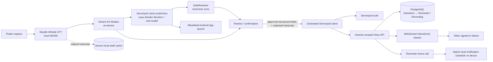

# Triage

**Catch the thought. Keep the context private.** Triage is a voice-driven inbox that turns spoken reminders, tasks, notes, shopping items, and ideas into structured cards. Its intended interaction is simple: tap to speak, review the interpretation, and save it into a synced inbox.

Triage is a Serverpod “Build Something Real” hackathon project. Whistle transcription, date resolution, and privacy filtering run on the device. Sanitized transcripts use a two-stage Serverpod action funnel with Laya and OpenAI-compatible tool-model adapters, plus a deterministic offline fallback. Raw transcripts remain in device-local storage and are not part of the server model. [Action-funnel configuration and verification](docs/ACTION_FUNNEL.md).

## Architecture



The diagram describes the architecture and intended flow; the verified platform boundaries below matter when running the current build.

## Product illustrations

The project includes three annotated concepts for the capture funnel, privacy boundary, and auto-save interaction:


*01 — Voice funnel. Capture feeds local transcription and PII scrubbing, then the action funnel prepares an inbox item or app launch.*


*02 — Privacy vault. Keep the original transcript local; only a sanitized transcript and structured fields are eligible for sync.*


*03 — Auto-save countdown. Valid confident actions can be saved after a short review window; uncertain or incomplete results require editing.*

## Stack

- Flutter / Dart client, with a custom dark Linear-inspired inbox and voice capsule.
- Cactus Needle Whistle for on-device speech transcription; Laya/OpenAI-compatible backend adapters and a pure Dart fallback for routing and slot extraction.
- A standalone deterministic Dart `DateResolver` for local relative-date interpretation.
- Desert Ant Labs Redact for local PII filtering, with a regex/Luhn defense-in-depth pass and fail-closed save behavior.
- Serverpod 4.0.4 generated client/server, official email auth, session-scoped endpoints, ORM relations, typed WebSocket events, and reminder future calls.
- PostgreSQL; Android native local alerts via `flutter_local_notifications`.

## Current verification and boundaries

Flutter client tests pass (59), backend unit/integration tests pass (65), and both analyzers are clean. The Whistle-only prepared Android bridge transcribed a prerecorded fixture without Needle routing. Laya/tool-model adapters have controlled contract tests; live model accuracy/latency and physical-phone execution still need validation. Earlier Web/Needle spike evidence remains in the historical reports.

This is a spike/hackathon build, not a claim of fully validated production behavior. The latest Desert Ant **browser** smoke initialized LiteRT but its Hugging Face model listing request returned HTTP 405 in this environment; browser model-backed redaction needs a successful host check before recording a browser privacy demo. The app blocks saving if redaction initialization fails. The Android APK now includes its WASM runtime and model files and has passed a local prerecorded-audio bridge smoke, but no Android handset was attached during this implementation turn, so native permission/microphone/inference still needs physical-device acceptance. Server/client multi-session event handling has automated tests, but a physical phone-to-laptop live sync demo has not yet been performed. See [the phone demo guide](docs/PHONE_DEMO_GUIDE.md) and [the detailed UI/platform report](docs/FLUTTER_UI.md) before presenting features as live-verified.

## Setup and run

### Requirements

- Windows PowerShell (commands below), Flutter 3.47.6 / Dart 3.13.5 or a compatible newer SDK, and Node.js 24 for browser Redact bundling.
- Serverpod CLI 4.0.4 for backend generation/run, and Android SDK/USB debugging for a native Android shell.
- Network access for first-time package/model downloads. The browser voice and Redact models are substantial downloads; see the platform caveats above.

This checkout keeps SDK/package caches under `.spike-cache`. From the repository root, configure the local tools (if present):

```powershell
$env:PUB_CACHE = "$PWD/.spike-cache/pub"
$env:PATH = "$PWD/.spike-cache/flutter/bin;$PWD/.spike-cache/flutter/bin/cache/dart-sdk/bin;$PWD/.spike-cache/pub/bin;$env:PATH"
```

If using your own installed Flutter/Dart and Serverpod CLI, put those binaries on `PATH` instead.

### Backend

```powershell
cd triage
flutter pub get
cd triage_server
./tool/init_secrets.ps1
serverpod generate
cd ..
serverpod start
```

`serverpod start` starts the configured local development database and API and applies pending migrations. The checked-in migrations cover the current schema; after changing model YAML, use `serverpod generate` and `serverpod create-migration <migration_name>` from `triage/triage_server`, then review and apply the generated migration. Keep the service running in this terminal. Local email verification codes are printed in its logs. For phone-on-Wi-Fi access, set the advertised host before startup, e.g. `$env:SERVERPOD_API_SERVER_PUBLIC_HOST = "192.168.1.25"`, and use a trusted LAN; see [PHONE_DEMO_GUIDE.md](docs/PHONE_DEMO_GUIDE.md).

### Flutter Web

In another PowerShell terminal from the repository root:

```powershell
./triage/triage_flutter/tool/prepare_web.ps1 -DownloadModels
cd triage/triage_flutter
flutter pub get
./tool/build_web.ps1
flutter run -d chrome --dart-define=SERVER_URL=http://localhost:8080/
```

The app requires a running backend for sign-in and persistence. Microphone access requires HTTPS or localhost. For a clearly labeled backend-free UI preview only:

```powershell
flutter run -d chrome --dart-define=TRIAGE_DEMO=true
```

### Phone / Android

For browser voice capture on a phone, the phone demo guide uses USB `adb reverse` and the Flutter Web server. The native Android APK uses the local Whistle-only worker, allowlisted Android intents and native reminders; prepare assets before building:

```powershell
./triage/triage_flutter/tool/prepare_web.ps1 -DownloadModels
cd triage/triage_flutter
flutter pub get
flutter run -d <ANDROID_DEVICE_ID> --dart-define=SERVER_URL=http://<PC_WIFI_IPV4>:8080/
```

Grant notification/exact-alarm permissions as requested. Scheduled notifications are unsupported on Web in the selected plugin. For LAN URLs, keep devices on a trusted network and configure Windows Firewall only for the Private profile. See [PHONE_DEMO_GUIDE.md](docs/PHONE_DEMO_GUIDE.md) for the full two-client procedure and limitations.

## Project docs

- [Product requirements](docs/PRD.md) · [Project plan](docs/PROJECT_PLAN.md)
- [Needle / Whistle spike results](docs/SPIKE_RESULTS.md) · [Date resolver](docs/DATE_RESOLVER.md)
- [Serverpod models and security](docs/SERVERPOD_SETUP.md) · [Flutter UI](docs/FLUTTER_UI.md)
- [Phone demo guide](docs/PHONE_DEMO_GUIDE.md) · [Demo video script](docs/DEMO_SCRIPT.md) · [Hackathon submission copy](docs/SUBMISSION.md)

## AI disclosure

- **Runtime AI:** Cactus Needle Whistle for local transcription and Desert Ant Labs Redact for on-device PII filtering. The backend can call Laya for domain decisions and a configured Liquid/OpenAI-compatible tool model for extraction. The default unconfigured/demo path uses deterministic rules; live model inference is not yet validated. Historical Needle 3 spike evidence remains documented separately.
- **Development assistance:** OpenAI Codex was used as a coding assistant in this project. Add any other coding assistants used by the team before submitting; this disclosure should reflect the full development history.
- **Authorship:** Team members remain responsible for reviewing generated code, model behavior, privacy claims, and the final submission.

Review the exact portal-ready text in [docs/SUBMISSION.md](docs/SUBMISSION.md).
