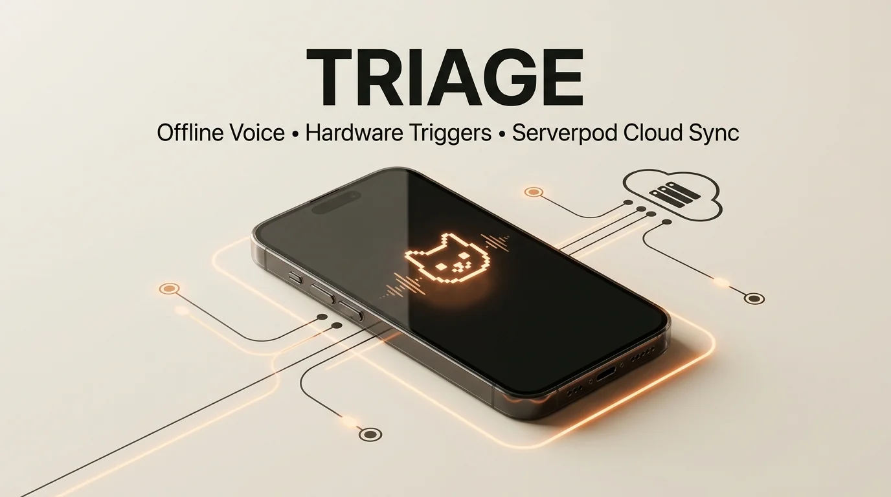
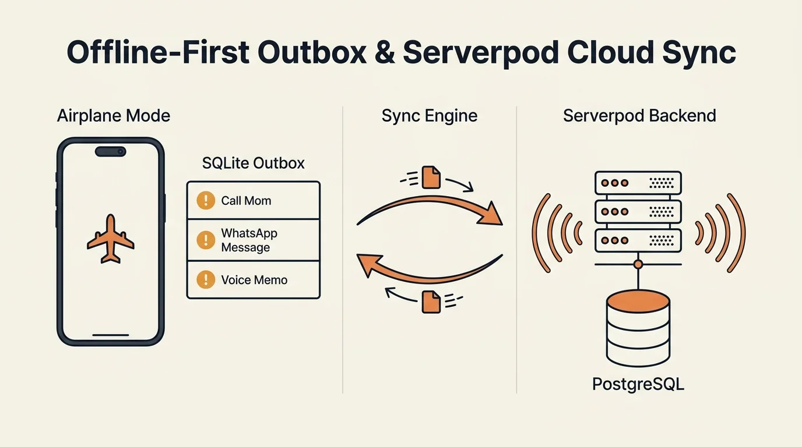
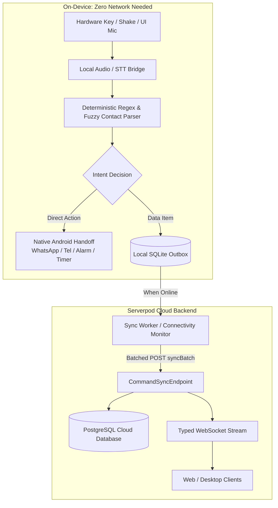
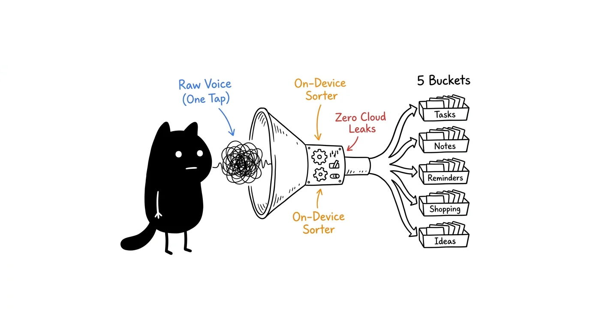
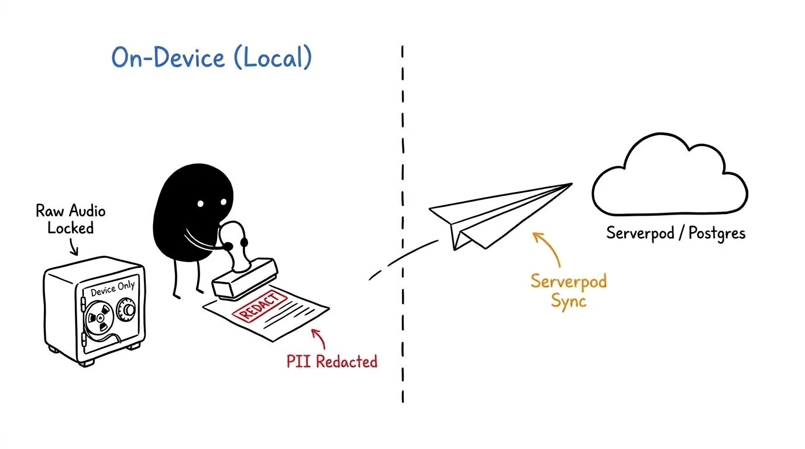
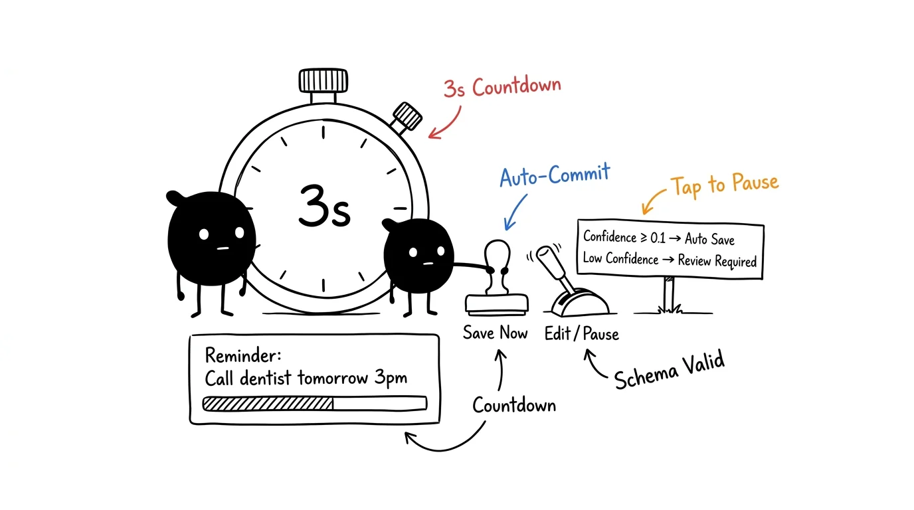

# Triage



**Instant thought capture. Instant physical action. Zero latency.**  
Triage is a privacy-first, offline-capable assistant designed for the **Serverpod "Build Something Real" Hackathon**. It combines hardware-triggered voice intake, on-device deterministic parsing, and local SQLite queueing with high-speed Serverpod cloud synchronization.

Whether you're offline on the subway or online at your desk, Triage lets you trigger reminders, notes, calls, WhatsApp messages, and timers instantly — then syncs seamlessly with Serverpod and PostgreSQL when connectivity is available.

---

## ⚡ Highlights

- **Hardware Button & Gesture Triggers**: Double-tap `Volume Up` or use **Volume Up + Shake** to summon the assistant in `<50ms` even with the screen off or when inside other apps.
- **100% Offline Core Actions**: WhatsApp handoff, phone calls, reminders, timer alarms, and quick voice notes parse and execute with zero network latency.
- **Offline SQLite Outbox**: Spoken commands are safely saved to a local outbox with retry logic and conflict-free sequence IDs.
- **Serverpod 4.0.4 Cloud Sync**: As soon as internet connectivity returns, the client syncs pending batches to Serverpod's PostgreSQL database and broadcasts live updates over typed WebSockets.
- **ASCII/Pixel Animated Assistant**: Minimalist warm-paper / obsidian UI (`#F8F7F2`, `#242521`, `#E78A4E`) featuring dynamic animated states (*Idle*, *Listening*, *Thinking*, *Speaking*, *Offline*).
- **Gemini Live Conversational Mode**: Switch seamlessly from instant offline triggers to an open-ended conversational session using BYOK Gemini Live WebSockets with direct PCM streaming.

---

## 🏗 Architecture & Offline-to-Cloud Sync





---

## 🗣 Offline Command Guide

Triage includes a built-in offline command reference accessible via the `?` icon in the app header:

| Category | Example Voice Commands | What Triage Does |
| :--- | :--- | :--- |
| **WhatsApp** | `"WhatsApp Dad I am on my way"`<br>`"Send a WhatsApp to Alice see you soon"` | Matches contact against pinned favorites and pre-fills WhatsApp chat ready to send |
| **Phone Calls** | `"Call Mom"`<br>`"Call Doctor on mobile"` | Looks up pinned contact phone number and launches direct native dialer |
| **Reminders** | `"Remind me to buy groceries tomorrow at 6 PM"`<br>`"Reminder take medicine in 2 hours"` | Parses relative date/time deterministically and sets a local notification |
| **Timers & Alarms** | `"Set a timer for 15 minutes"`<br>`"Set an alarm for 7 AM tomorrow"` | Sets system clock alarms directly via native Android intents |
| **Quick Notes** | `"Note down meeting ideas for tomorrow"`<br>`"Take a note buy coffee beans"` | Immediately persists to local SQLite and queues for Serverpod sync |

---

## Product Illustrations

The project includes verified architectural diagrams for privacy, capture pipelines, and review workflows:



*01 — Voice funnel. Capture feeds local transcription and PII scrubbing, then the action funnel prepares an inbox item or app launch.*



*02 — Privacy vault. Keep the original transcript local; only a sanitized transcript and structured fields are eligible for sync.*



*03 — Auto-save countdown. Valid confident actions can be saved after a short review window; uncertain or incomplete results require editing.*

## Stack

- **Flutter / Dart Client**: Custom warm-paper minimalist design system with Forui Lucide icons, responsive sheets, and ASCII animated assistant.
- **Serverpod 4.0.4 Backend**: Custom endpoints (`CommandSyncEndpoint`, `RoutineEndpoint`, `TelemetryEndpoint`, `DeviceEndpoint`), typed future calls, ORM relations, and PostgreSQL persistence.
- **Android Native Layer**: Kotlin `TriggerKeyService` and `BackgroundShakeService` for low-latency physical triggers, plus `NativeActionBridge` for intent handoffs.
- **SQLite Outbox**: Local queueing via `sqlite_async` ensuring zero data loss during network dropouts.
- **Gemini Live**: Direct bi-directional WebSocket streaming with 16kHz PCM audio and low-latency audio playback.

## Setup and Run

### Requirements

- Flutter SDK, Dart SDK, and Android SDK (for physical device or emulator).
- Serverpod CLI 4.0.4 for backend run & code generation.
- PostgreSQL (or local Docker container for Serverpod database).

### Backend

```powershell
cd triage/triage_server
serverpod generate
serverpod start
```

### Android App

```powershell
cd triage/triage_flutter
flutter pub get
flutter run
```
