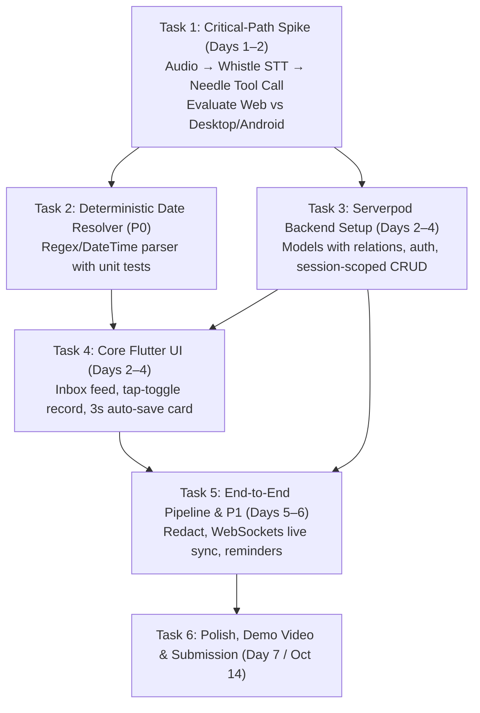

# Triage — Project Execution Plan & Task Tracker

> **Hackathon Deadline:** Oct 14, 2026, 23:59 CEST (**Oct 15, 2026, 03:29 IST**)  
> **Today:** Day 1 (Oct 7, 2026)

---

## 1. Execution Order & Prioritization

---

## 2. Detailed Task Breakdown

### Task 1: Critical-Path Spike (Oct 7–8) ⚠️ Highest Risk
- [ ] Create bare Flutter experimental runner.
- [ ] Record sample audio from microphone (or load pre-recorded audio bytes).
- [ ] Validate **Needle Whistle** (`needle.transcribe()`) on-device speech transcription.
- [ ] Validate **Needle tool-calling engine**:
  - Test if confidence output is provided by the engine.
  - Test if multiple tool calls per utterance work natively (e.g. `"eggs, milk, and bread"` $\rightarrow$ 3 `add_shopping_item`). If not, prepare client-side utterance splitter.
  - Test 5 daily validation utterances.
- [ ] Determine primary platform:
  - Check Flutter Web (JS SDK + WASM, bundle size & mic limitations).
  - If Web encounters blockers, switch immediately to Windows/Desktop or Android via `dart:ffi`.
- [ ] Record findings in a Spike Results note.

---

### Task 2: Deterministic On-Device Date Resolver (P0)
- [ ] Build standalone Dart module `DateResolver`.
- [ ] Parse relative expressions:
  - `"tomorrow 3pm"`, `"tomorrow at 3"` $\rightarrow$ next day 15:00.
  - Day names: `"Friday"`, `"next Monday at 10am"`.
  - Durations: `"in 2 hours"`, `"in 30 minutes"`.
- [ ] Comprehensive unit tests verifying timezone and leap/month boundaries.

---

### Task 3: Serverpod Backend Scaffolding & ORM Relations (Oct 8–10)
- [ ] Check installed `serverpod` CLI and module versions (verify user ID types: `int` vs `UuidValue`).
- [ ] Define YAML models with relations:
  - `InboxItem`: `userId`, `type`, `title`, `body`, `tags`, `priority`, `dueDate`, `redactedTranscript`, `isCompleted`, relations to `Reminder` and `Recording`.
  - `Reminder`: `inboxItemId`, relation to `InboxItem`, `triggerAt`, `isFired`.
  - `Recording`: `inboxItemId`, relation to `InboxItem`, `storageUrl`, `durationMs`.
- [ ] Run `serverpod generate` and generate database migrations.
- [ ] Configure `serverpod_auth` module (no custom `AuthEndpoint`).
- [ ] Implement `InboxEndpoint`:
  - `requireLogin = true`.
  - Set `userId` from `(await session.authenticated)?.userId` on `createItem`.
  - Scope all `listItems`, `completeItem`, `deleteItem` queries to session user.
- [ ] Implement `SyncEndpoint` (WebSocket stream for live sync).

---

### Task 4: Flutter Core UI & Audio Capture (Oct 8–10)
- [ ] Set up Serverpod client and auth state management.
- [ ] Tap-to-toggle microphone button (tap to record, tap to stop).
- [ ] Confirmation card with:
  - Extracted fields summary.
  - 3-second animated auto-save countdown.
  - "Edit" and "Cancel" buttons.
  - Fallback "Edit Required" state when schema parsing is ambiguous.
- [ ] Inbox feed:
  - Category filter chips (`All`, `Tasks`, `Notes`, `Reminders`, `Shopping`, `Ideas`).
  - Color-coded badges & tag chips.
  - Swipe right to complete, swipe left to delete.

---

### Task 5: End-to-End Pipeline & P1 Features (Oct 11–12)
- [ ] Wire full on-device pipeline:
  `Tap Stop → Whistle STT → Needle Tool-Calling → DateResolver → Desertant Redact → Serverpod sync`.
- [ ] Retain `originalTranscript` strictly in local device storage.
- [ ] Connect `SyncEndpoint` stream for two-client live synchronization.
- [ ] Add `flutter_local_notifications` for reminder alerts.
- [ ] (P1) Desertant Gist (topics) & Emo (emojis).

---

### Task 6: Submission Polish & Demo (Oct 13 – Oct 14)
- [ ] Run 6 daily test utterances to ensure zero regression.
- [ ] Record <2-minute demo video showing:
  1. Voice capture $\rightarrow$ structured auto-save with 3s timer.
  2. Multi-item shopping parsing.
  3. Note with privacy guarantee (local raw vs server redacted).
  4. Two-client live sync (phone $\rightarrow$ laptop web tab in real time).
- [ ] Write README with setup and run instructions.
- [ ] Disclose all AI tools used.
- [ ] Final submission before **Oct 14, 23:59 CEST** (**Oct 15, 03:29 IST**).

---

## 3. Daily Test Utterances Benchmark

1. `"Remind me to call the dentist tomorrow at 3pm"`
2. `"Buy eggs, milk, and bread from Whole Foods"`
3. `"The client meeting went well, they approved the Q4 budget"`
4. `"Fix the login bug by Friday, high priority"`
5. `"What if we made the onboarding a game?"`
6. `"Um, so, email Sarah about the proposal, and oh, grab milk"`
